# AutoPocket Diary

### The money diary that fills itself in.

Most expense trackers make you type every purchase. **AutoPocket Diary reads the transaction SMS your bank and bKash already send you and does the bookkeeping for you**: what came in, what went out, from which account and card, and where it went.

Free. Works fully offline. Your data never leaves your phone.

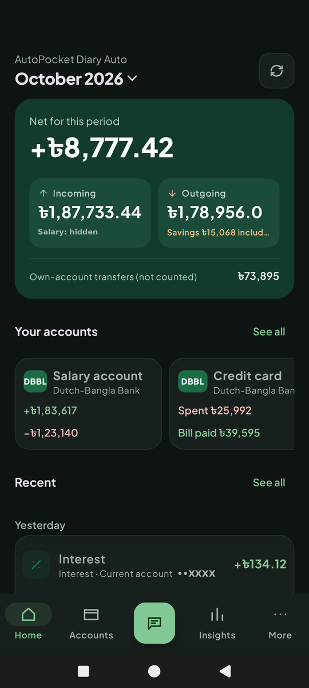
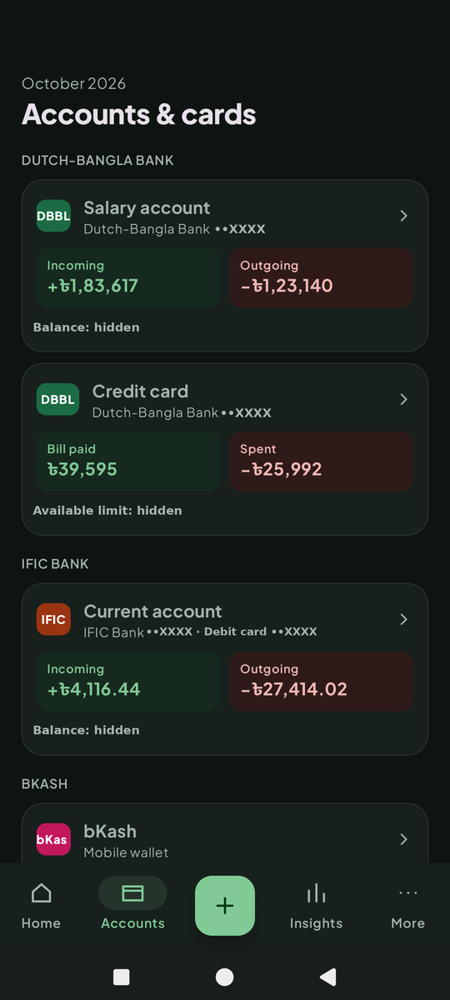
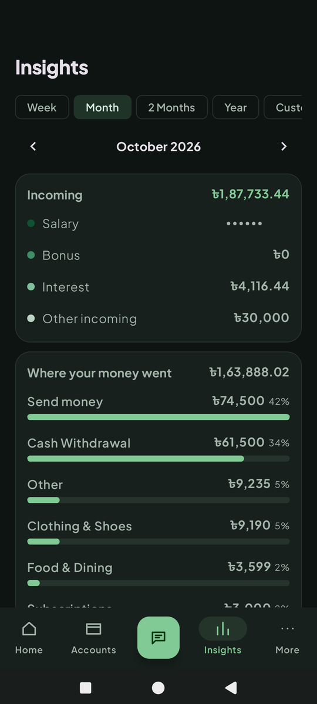
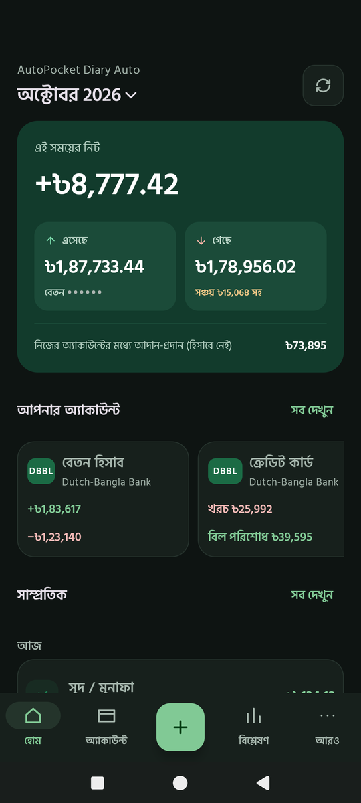

Screenshots from a real phone; account numbers, salary and balances are hidden.

Created by **Md. Mazid-Ul-Haque**. © 2026, all rights reserved (see [LICENSE](LICENSE)).

**[⬇ Download the latest version](https://github.com/MazidUlHaque/AutoPocket-Diary/releases/latest)**. This is the only official download.

[বাংলায় পড়ুন ↓](#বাংলায়)

---

## What it does for you, automatically

| You'd normally have to… | AutoPocket Diary does it by itself |
|---|---|
| Type in every card swipe, transfer and bill | Reads bank and wallet SMS: card purchases, ATM, transfers, bills, salary, bonus, interest, DPS, insurance, charges and tax |
| Work out which account or card was used | Finds each account and card in your SMS (e.g. DBBL ••XXXX, Visa ••XXXX) and keeps separate totals for each |
| Sort spending into categories | Recognises shops and billers (Bata → Clothing & Shoes, Shwapno → Groceries, DESCO → Electricity, …) and learns from any change you make |
| Avoid counting money twice | Spots money moving between your own accounts (bank → bank, card → bKash, credit card bill payments) and leaves it out of the totals |
| Clean up junk | Skips OTPs, offers, statements, failed transactions, receipts and duplicate SMS |
| Separate real income | Shows salary, bonus and interest on their own lines, and DPS, insurance and investments as "savings" |

It only asks you when it really can't tell, and only once:

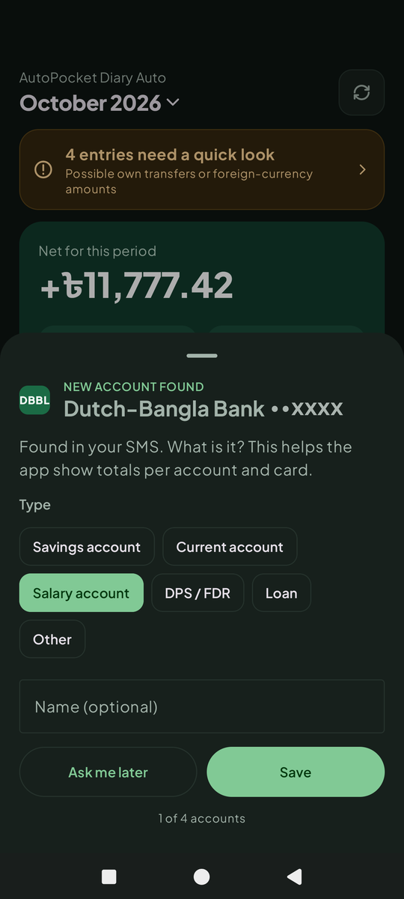

- **"New account found"**: is this a salary account, savings account, credit card…? You answer once, and from then on everything is sorted per account.
- **"Needs a quick look"**: a possible transfer between your own accounts that neither SMS confirms, or a foreign-currency purchase that needs its taka amount.

## Two editions: which one?

| | **AutoPocket Diary** (recommended) | **AutoPocket Diary Auto** |
|---|---|---|
| File | `AutoPocketDiary.apk` | `AutoPocketDiary-Auto.apk` |
| How SMS get in | **Automatic daily import** from the free *SMS Backup & Restore* app, or **share** / **paste** an SMS, or import a backup file | Reads bank and wallet SMS from your inbox **by itself** |
| SMS permission | **None** | Read SMS |
| Installing | Installs normally | Needs a few one-time steps (below) |

Everything else is the same in both. They can be installed side by side; each keeps its own data.

**Why does the Auto edition need extra steps?** In several countries Google Play Protect blocks *every* app downloaded outside the Play Store that asks to read SMS, because scam apps misuse SMS to steal OTPs. It's a blanket rule, not a judgement of this app.

## How to install

1. On your Android phone, open the **[download page](https://github.com/MazidUlHaque/AutoPocket-Diary/releases/latest)** and tap **AutoPocketDiary.apk** (or **AutoPocketDiary-Auto.apk**).
2. Open the downloaded file.
3. If Android says **"your phone is not allowed to install unknown apps from this source"**, tap **Settings**, turn on **Allow from this source**, and go back.
4. Open the app and read the welcome screens.

**Updating:** install the new APK over the old one. Your data is kept.

**Check it's genuine (optional):** in the app open **More → About & privacy**. It should say "Official version", and its signing fingerprint should match the one on the download page.

## Setting up SMS (one time)

### Auto edition: step by step

**1. If Play Protect says "App blocked to protect your device":** open the **Play Store**, tap your profile picture, then **Play Protect** → ⚙ (top right) → turn off **Scan apps with Play Protect** → choose **Pause**. Install the app. Scanning turns itself back on the next day, or you can turn it back on right away.

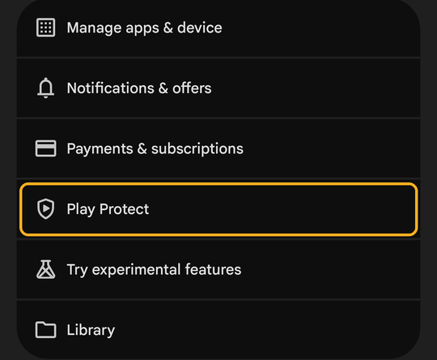
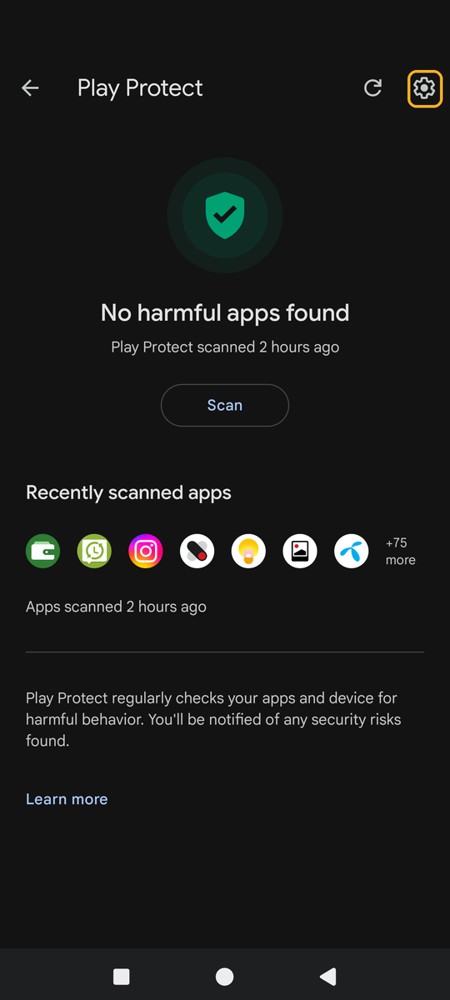
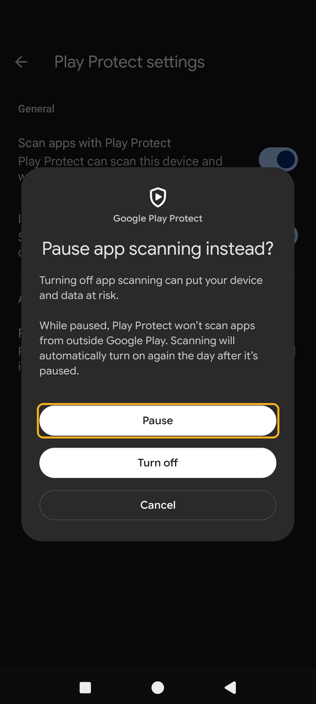

**2. Allow SMS.** Open the app and tap **Allow SMS access**. If Android says the app was denied access, the app opens its guide. Tap **Open app info**, then **⋮** (top-right) → **Allow restricted settings**, and confirm with your phone lock.

**3.** Still on app info, tap **Permissions → SMS → Allow**, and come back to the app. It reads your SMS straight away.

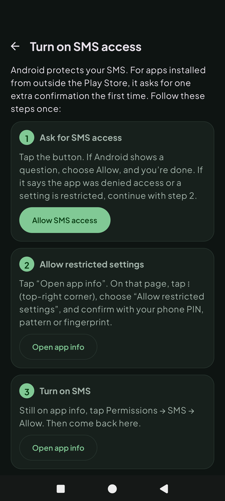
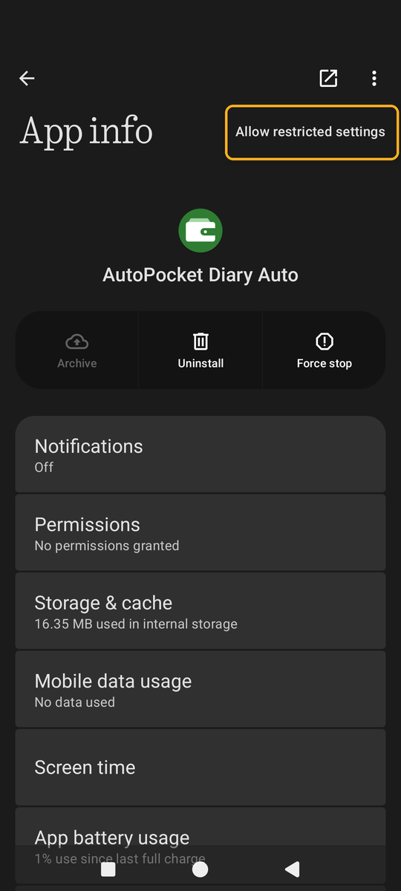
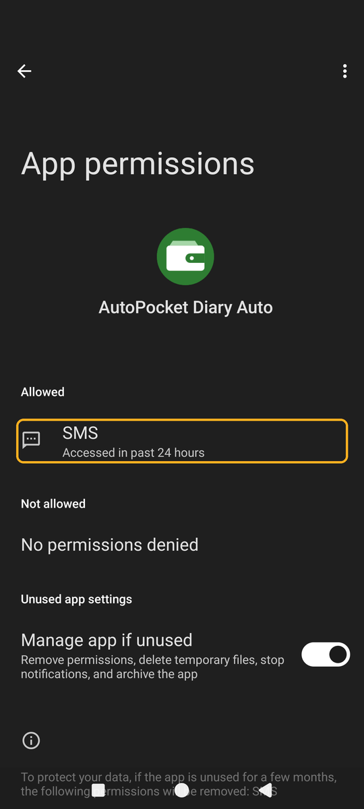

The guide is always available in the app under **More → SMS access**. If your phone never shows "Allow restricted settings", use the standard edition instead.

### Standard edition: automatic, no permission

1. Install the free **SMS Backup & Restore** app from the Play Store.
2. In it: **Set up a backup** → **Messages** only → choose a **folder on your phone** (not Google Drive) → **Schedule: daily**.
3. In AutoPocket Diary: **More → Add from SMS → Choose backup folder**, and pick that folder.

From then on, every time you open AutoPocket Diary it reads the newest backup and adds new transactions by itself, with no duplicates. For a single SMS you can also long-press it in your Messages app → **Share** → **AutoPocket Diary**.

## Also included

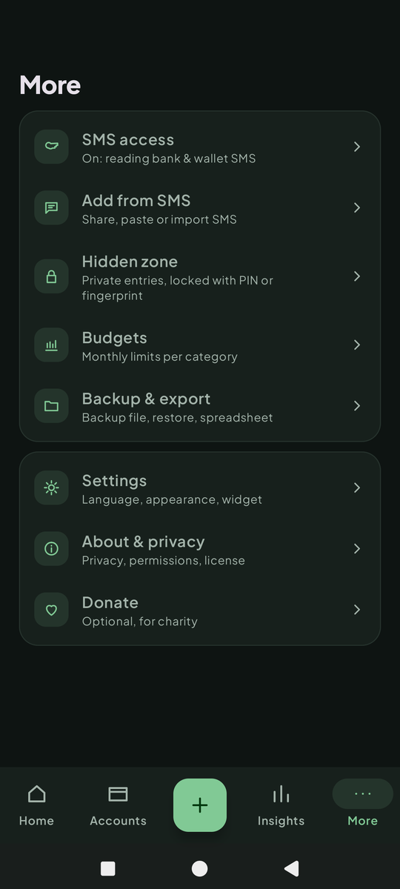

- **Any period:** week, month, 2 months, year, or your own dates.
- **Monthly budgets** per category, with a warning at 80% and when you go over.
- **Hidden zone:** move private entries into a locked area with its own totals (app PIN or fingerprint).
- **Backup on your phone:** a password-locked backup file to keep before resetting or changing phones, plus spreadsheet (CSV) export. No online backup.
- **Home-screen widget**, **বাংলা and English**, **light and dark**.

## Adding entries by hand (if you ever need to)

The big button in the middle of the app brings SMS in (**Scan SMS now** / **Add from SMS**). For cash spending that never sends an SMS, tap it and choose **Add a cash entry by hand** at the bottom. You can also edit any automatic entry: give it a title ("Shoes"), change its category, or leave it out of the totals.

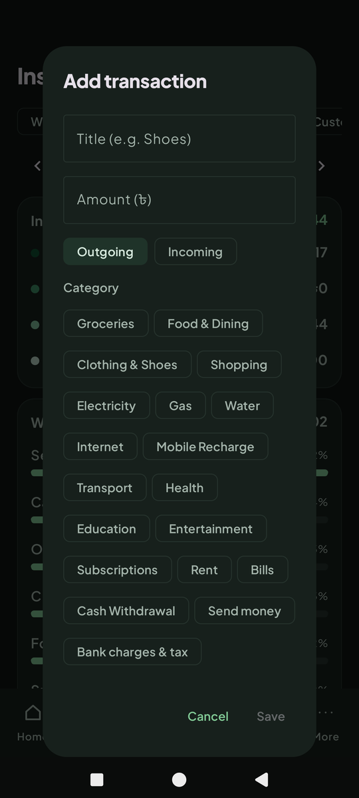

## Your privacy

- **Everything stays on your phone.** The app has **no internet permission**, so it *cannot* send your data to the developer or anyone else. Every build is checked automatically to keep it that way.
- Data is stored **encrypted** and is **not** copied to Google backup.
- No ads, no accounts, no sign-up.
- SMS that aren't bank or wallet transactions are skipped and never stored.
- Full policy: [Privacy policy](docs/PRIVACY.md).

**The developer will never call you or ask for your PIN, OTP or password.**

## Google Play edition

A Play Store version (**AutoPocket Diary**, with the same automatic SMS reading as the Auto edition) is being prepared. On Play it installs normally, with no Play Protect steps. Until it's live, use the APKs above. Publishing notes are in [docs/PLAY_STORE_GUIDE.md](docs/PLAY_STORE_GUIDE.md) and store graphics in [docs/play-store](docs/play-store).

## Limits

- It only sees transactions that sent an SMS (in the standard edition, the SMS you bring in).
- It may sometimes misread an SMS; you can edit or delete any entry.
- It's a personal record, not financial advice. Not affiliated with bKash, Nagad, Rocket, Upay or any bank.

## Fonts

The app includes [Plus Jakarta Sans](https://fonts.google.com/specimen/Plus+Jakarta+Sans) and [Hind Siliguri](https://fonts.google.com/specimen/Hind+Siliguri), both under the SIL Open Font License (copies in `app/src/main/assets/licenses`).

---

## বাংলায়

### যে টাকার ডায়েরি নিজেই নিজেকে লেখে।

বেশিরভাগ খরচের অ্যাপে প্রতিটি খরচ হাতে লিখতে হয়। **AutoPocket Diary আপনার ব্যাংক আর বিকাশের পাঠানো লেনদেনের SMS পড়ে নিজেই হিসাব করে:** কত এলো, কত গেল, কোন অ্যাকাউন্ট বা কার্ড থেকে, আর কোন খাতে।

- প্রতিটি অ্যাকাউন্ট ও কার্ড নিজে খুঁজে বের করে আলাদা হিসাব রাখে।
- দোকান ও বিল চিনে খাত ঠিক করে (Bata → পোশাক ও জুতা, Shwapno → বাজার-সদাই, DESCO → বিদ্যুৎ)।
- নিজের এক অ্যাকাউন্ট থেকে আরেক অ্যাকাউন্টে টাকা সরালে তা দুবার গোনে না।
- বেতন, বোনাস ও সুদ আলাদা দেখায়; ডিপিএস, বিমা ও বিনিয়োগ "সঞ্চয়" হিসেবে দেখায়।
- OTP, অফার, ব্যর্থ লেনদেন আর একই SMS দুবার এলে বাদ দেয়।
- শুধু যেখানে নিশ্চিত হতে পারে না, সেখানেই একবার জিজ্ঞেস করে।

**গোপনীয়তা:** সব তথ্য শুধু আপনার ফোনেই থাকে। অ্যাপটির ইন্টারনেট ব্যবহারের অনুমতি নেই, তাই এটি আপনার কোনো তথ্য ডেভেলপার বা অন্য কারও কাছে পাঠাতে পারে না। তথ্য ফোনে এনক্রিপ্ট করে রাখা হয়।

**দুটি সংস্করণ:**
- **AutoPocket Diary** (`AutoPocketDiary.apk`, সবার জন্য): স্বাভাবিকভাবে ইনস্টল হয়, SMS পড়ার অনুমতি লাগে না। ফ্রি *SMS Backup & Restore* অ্যাপ দিয়ে প্রতিদিন ফোনের একটি ফোল্ডারে ব্যাকআপ রাখুন, আর অ্যাপে **আরও → SMS থেকে যোগ করুন → ব্যাকআপ ফোল্ডার বাছুন**। এরপর অ্যাপ খুললেই নতুন লেনদেন নিজে যোগ হবে।
- **AutoPocket Diary Auto** (`AutoPocketDiary-Auto.apk`): ইনবক্স থেকে নিজেই SMS পড়ে, তবে একবার কয়েকটি ধাপ লাগে:
  1. Play Protect "App blocked" দেখালে: Play Store → প্রোফাইল ছবি → Play Protect → ⚙ → "Scan apps with Play Protect" বন্ধ করে **Pause** বাছুন, তারপর ইনস্টল করুন।
  2. অ্যাপে **SMS পড়ার অনুমতি দিন** চাপুন। আটকে গেলে: **অ্যাপ ইনফো খুলুন → ⋮ → Allow restricted settings**।
  3. একই পাতায় **Permissions → SMS → Allow**।
  অ্যাপের ভেতরে **আরও → SMS পড়ার অনুমতি**-তে বোতামসহ এই নির্দেশনা আছে। ওপরের ছবিগুলোতে প্রতিটি ধাপ দেখানো আছে।

**ইনস্টল:** ফোনে **[ডাউনলোড পেজ](https://github.com/MazidUlHaque/AutoPocket-Diary/releases/latest)** খুলে APK ডাউনলোড করুন, ফাইলটি খুলুন। "unknown apps" অনুমতি চাইলে **Settings → Allow from this source** চালু করুন।

**হাতে এন্ট্রি:** অ্যাপের মাঝের বড় বোতামটি SMS আনার জন্য (**এখনই SMS খুঁজুন** / **SMS থেকে যোগ করুন**)। যে নগদ খরচের SMS আসে না, শুধু সেগুলোর জন্য একই বোতাম চেপে নিচের **নগদ খরচ হাতে যোগ করুন** বাছুন।

**ডেভেলপার কখনো ফোন করে আপনার PIN বা OTP চাইবেন না।** বিস্তারিত: [গোপনীয়তা নীতি](docs/PRIVACY.md)।
